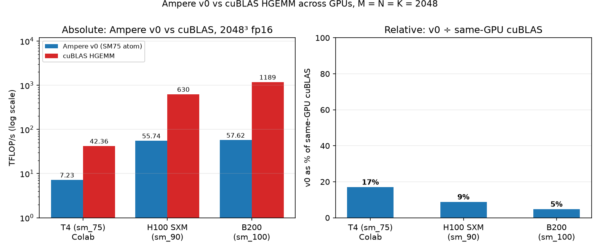
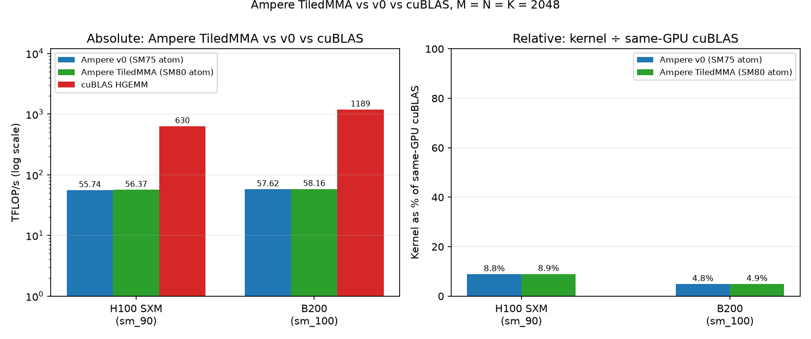

# CUTLASS/CuTe Practice: Ampere → Hopper → Blackwell

### NOTE: All Kernels Are Handwritten For Learning Purposes. Claude/DeepSeek Helped With Benchmarking.

These are fp16 tensor-core GEMMs written with CUTLASS/CuTe, organized by target architecture. The original T4-era kernel and its SM80 follow-up live under `Ampere/`; the Hopper and Blackwell paths follow Colfax's CUTLASS tutorials. Each kernel version is benchmarked against cuBLAS, so every optimization is measured against a fixed reference.

**Update (Oct 2026): I'm GPU-rich now.** That T4 phase is over: I discovered I had ~$1,000 of unused Modal credits from the NVIDIA FlashInfer competition in February 2026 — even though I didn't take part in it — and Charles Frye of Modal also gave me ~$60 in GPU credits. Thanks to [Bikram Mahji](https://github.com/bikrammajhi) for the heads-up. The T4 numbers below stay as the original baseline; the H100 and B200 tables were profiled on Modal.

## Layout

| Path | Target | What it is | Status |
|---|---|---|---|
| `Ampere/01_naive_cute.cu` | SM75 atom | v0: fragments loaded global → register | Benchmarked |
| `Ampere/02_tiled_mma_sm80.cu` | SM80 atom | explicit `TiledMMA`, 16x8x16 fp16 → fp32 | Benchmarked |
| `Hopper/01_wgmma_sm90.cu` | SM90 | WGMMA scaffold | Scaffold |
| `Blackwell/01_mma_sm100.cu` | SM100 | UMMA / Tensor Memory scaffold | Scaffold |
| `tiledCopy.cu` | generic | global → shared `TiledCopy` exercise | WIP |
| `vedAdd.cu` | generic | CuTe vector-add exercise | WIP |
| `figures/` | — | generated benchmark plots | — |

The directory names and file numbering follow the CuTe tutorial convention (`sgemm_sm80`, `tiled_copy`, `wgmma_sm90`, `01_mma_sm100`). The Hopper and Blackwell tracks follow Colfax's CUTLASS tutorial series.

## Ampere

The only kernel family benchmarked so far. The Ampere-targeted kernels are also run on H100 and B200 for a cross-generation comparison; v0 additionally keeps its original T4 baseline.

### Results

Problem: `M = N = K = 2048`, fp16 inputs, fp32 accumulation. The T4 table is the original v0 GPU-poor baseline; the H100 and B200 tables rerun v0 plus an explicit TiledMMA variant on Modal with the same harness.

The two implemented kernels are `Ampere/01_naive_cute.cu` (v0) and `Ampere/02_tiled_mma_sm80.cu` (explicit `TiledMMA`).

#### Tesla T4 (sm_75) — Colab baseline

| Version | Time (ms) | TFLOP/s | % of cuBLAS | What changed |
|---|---|---|---|---|
| cuBLAS (reference) | 0.406 | 42.36 | 100% | `cublasGemmEx`, tensor-op algo |
| v0: naive CuTe (SM75 atom) | 2.375 | 7.23 | 17% | Fragments loaded straight from global memory |
| v1: shared memory | TBD | TBD | TBD | Cooperative global-to-shared copy |
| v2: vectorized copy | TBD | TBD | TBD | `TiledCopy` with 128-bit loads |
| v3: swizzled smem | TBD | TBD | TBD | Bank-conflict-free shared layout |
| v4: pipelined | TBD | TBD | TBD | Overlap next k-tile load with MMA |

#### NVIDIA H100 SXM 80GB (sm_90) — Modal

| Version | Time (ms) | TFLOP/s | % of cuBLAS | What changed |
|---|---|---|---|---|
| cuBLAS HGEMM (reference) | 0.027 | 630.38 | 100% | same `cublasGemmEx` call as the T4 row |
| v0: naive CuTe (SM75 atom) | 0.308 | 55.7 | 9% | not changed — same SM75 atom, still no shared memory |
| tiled MMA: explicit `TiledMMA` (SM80 atom) | 0.305 | 56.4 | 9% | SM80 `16x8x16` atom, fp32 accumulate; still global → register, no smem |

NCU (full set): v0 sits at Memory SOL **92.5%**, driven by **L1/TEX at 96.5%**, while Compute is 11.6% and DRAM 1.9% — every operand tile is re-read through the L1 datapath, so the tensor cores mostly wait. The explicit TiledMMA variant is the same story: **93.7% Memory SOL, 97.7% L1/TEX, 11.7% Compute, 1.9% DRAM** (302.7 µs vs 307.7 µs). Its L1TEX scoreboard stall is 57% of the 27.2 cycles between issued instructions, and it still needs 255 registers/thread. v0 is **7.7× faster** than on T4 in absolute terms, yet a *smaller* fraction of cuBLAS: the latency-limited naive kernel barely scales, while cuBLAS's tuned Hopper path does.

#### NVIDIA B200 (sm_100) — Modal

| Version | Time (ms) | TFLOP/s | % of cuBLAS | What changed |
|---|---|---|---|---|
| cuBLAS HGEMM (reference) | 0.014 | 1188.71 | 100% | same `cublasGemmEx` call again |
| v0: naive CuTe (SM75 atom) | 0.298 | 57.6 | 5% | still the same SM75 atom; v0 gains only ~3% over its own H100 number while cuBLAS almost doubles |
| tiled MMA: explicit `TiledMMA` (SM80 atom) | 0.295 | 58.2 | 5% | SM80 `16x8x16` atom, fp32 accumulate; same data path as v0 |

NCU (full set, 41 passes): the same L1 wall — v0 is at **L1/TEX 95.9%** and Memory SOL 83.0%, with Compute 20.4% and DRAM 0.72% (IPC 0.39, 303.3 µs vs 307.7 µs on H100 at the same ~1.8 GHz). The TiledMMA variant is **96.5% L1/TEX, 83.7% Memory SOL, 0.73% DRAM** and completes in 299.5 µs; its Compute (SM) metric falls to 10.5% because the K=16 atom halves the number of MMA instructions, not because the data path improved. Blackwell's wider SM buys a little more compute headroom, not a better data path: the naive global-to-register pipeline still saturates L1 while the tensor cores wait.

#### Cross-GPU takeaway

The gap widens every generation: **17% → 9% → 5%** of same-GPU cuBLAS. v0 barely moves from H100 to B200 (55.7 → 57.6 TFLOP/s) because its ceiling is the L1/latency path of the naive global-to-register pipeline, not FLOPs — while cuBLAS (630 → 1189 TFLOP/s) rides Blackwell's tensor cores, TMA and wider memory system. The explicit TiledMMA variant gains only **1.1% on H100 and 0.9% on B200**: a wider K=16 atom trims instruction count but leaves the data path untouched, so it is not a step on the optimization ladder. That is precisely what the v1+ ladder (shared memory → `TiledCopy` → swizzling → pipelining) is meant to recover.



*Generated by `figures/make_figures.py` from the runner's `bench_all.csv` (medians per GPU); the T4 bars are the original Colab baseline from the table above.*



*The explicit TiledMMA variant is within ~1% of v0 on both GPUs: a wider MMA atom reduces instruction count, but the global-to-register L1 path still sets the wall. This figure is H100/B200 only because the SM80 atom cannot run on the T4.*

### v0: naive CuTe baseline

- **File:** `Ampere/01_naive_cute.cu`.
- **Tile:** 128 x 128 x 32 per thread block, 128 threads (2 x 2 warps).
- **MMA atom:** `SM75_16x8x8_F32F16F16F32_TN` (Turing tensor core, fp16 in, fp32 accumulate).
- **Data path:** global memory directly into registers, then MMA. No shared memory, no pipelining.
- **Why it is slow:** every warp fetches its own A and B fragments from global memory, so the same tile data is loaded repeatedly and nothing hides memory latency. This is the number the later versions are meant to beat.
- **Layouts:** `A` is `M x K` row-major, `B` is stored `N x K` (K contiguous), so the kernel computes `C = A * B^T`, with `C` row-major.
- **Limitations:** no bounds handling, so M, N, K must be multiples of 128, 128, 32.

### Explicit TiledMMA practice kernel

`Ampere/02_tiled_mma_sm80.cu` rebuilds the same 128 x 128 x 32 block tile around an explicit `TiledMMA` object instead of the flat `matmulCute` path:

- **Tile:** 128 x 128 x 32 per block, 128 threads (2 x 2 warps).
- **MMA atom:** `SM80_16x8x16_F32F16F16F32_TN` — fp16 inputs, fp32 accumulate, K=16 per instruction.
- **Construction:** global aliases define `mma_op`, `mma_traits`, and `mma_atom`; `MMA` is the `TiledMMA` returned by `make_tiled_mma(mma_atom{}, MMA_EU_RepeatT{}, MMA_P_T{})` (2x2x1 execution-unit repeat, 32x32x16 permutation tile). The kernel then calls `partition_A/B/C` and `partition_fragment_A/B/C`, loops over every K tile, clears the accumulator, and calls `gemm(tiled_mma, tCrC, tArA, tBrB, tCrC)`.
- **Data path:** still global memory directly into registers. No shared memory, no `TiledCopy`, no pipelining, no bounds checks.
- **Result:** correctness is exact (0 mismatches, max abs error 0), and it runs at 0.305 ms / 56.4 TFLOP/s on H100 and 0.295 ms / 58.2 TFLOP/s on B200. That is only ~1% faster than v0, and still **8.9% / 4.9% of same-GPU cuBLAS**. The NCU profile confirms why: the L1/TEX wall is unchanged, so the wider atom only reduces instruction count.
- **Limitations:** the SM80 atom requires sm_80+, so there is no T4 row for this variant. M, N, K must remain multiples of 128, 128, 32.

## Hopper

Following Colfax's Hopper GEMM tutorials:

- [Fast Matrix-Multiplication with WGMMA on Hopper](https://research.colfax-intl.com/cutlass-tutorial-wgmma-hopper/) — WGMMA fragments, layouts, and synchronization.
- [Mastering the Tensor Memory Accelerator (TMA)](https://research.colfax-intl.com/tutorial-hopper-tma/) — TMA load/store, multicast, and swizzling.
- [Efficient GEMM Kernel Designs with Pipelining](https://research.colfax-intl.com/cutlass-tutorial-design-of-a-gemm-kernel/) — multistage and warp-specialized pipelines.

Current scaffold: `Hopper/01_wgmma_sm90.cu`.

Planned progression:

| File | Topic | Status |
|---|---|---|
| `01_wgmma_sm90.cu` | single-stage WGMMA GEMM | Scaffold |
| `02_wgmma_tma_sm90.cu` | TMA loads feeding WGMMA | Planned |
| `03_pipeline_sm90.cu` | multistage / warp-specialized pipeline | Planned |

There are no Hopper-kernel benchmark rows yet. They will be added here once the first WGMMA kernel runs.

## Blackwell

Following Colfax's Blackwell tensor-memory series:

- [Writing GEMM Kernels Using Tensor Memory for Blackwell](https://research.colfax-intl.com/cutlass-tutorial-writing-gemm-kernels-using-tensor-memory-for-nvidia-blackwell-gpus/) — UMMA, Tensor Memory, and the SM100 kernel shape.
- Later parts cover clusters and TMA multicast, sub-byte MMA, and block scaling.

Current scaffold: `Blackwell/01_mma_sm100.cu`.

Planned progression mirrors the CuTe tutorial examples:

| File | Topic | Status |
|---|---|---|
| `01_mma_sm100.cu` | SM100 UMMA + Tensor Memory | Scaffold |
| `02_mma_tma_sm100.cu` | TMA-fed UMMA | Planned |
| `03_mma_tma_multicast_sm100.cu` | clusters + TMA multicast | Planned |
| `04_mma_tma_2sm_sm100.cu` | 2-SM MMA / CTA pairs | Planned |
| `05_mma_tma_epi_sm100.cu` | epilogue and full GEMM | Planned |

There are no Blackwell-kernel benchmark rows yet. They will be added here once the first SM100 kernel runs.

## Methodology

Same kernels, same harness: `Ampere/01_naive_cute.cu` (v0) and `Ampere/02_tiled_mma_sm80.cu` (explicit `TiledMMA`) compiled per-arch against CUTLASS **v4.8.1 (commit `2c85f49`)**, pinned in the Modal images at `/opt/cutlass` (release tarball, no in-image git). The T4 baseline predates the TiledMMA variant, which needs an sm_80+ atom. After the architecture reorg, both kernels were recompiled and rerun on H100 and B200; correctness stayed at 0 mismatches / max abs error 0, and the table medians were unchanged.

| | Tesla T4 (sm_75) | H100 SXM 80GB (sm_90) | B200 (sm_100) |
|---|---|---|---|
| Where | Google Colab | Modal | Modal |
| CUDA | 13.0 (nvcc 13.0.88) | 12.4.0 | 13.3.1 — sm_100 needs ≥ 12.8, and CUTLASS 4.x recommends 13.3 for codegen |
| GPU selection | — | requested as `"H100!"`: Modal otherwise silently upgrades a plain `"H100"` request to an H200 (141 GB HBM, extra bandwidth), which would move the numbers | `"B200"` |
| NCU | — | `full` set on the first timed launch (skip 4 = correctness + 3 warmup launches), with the CUDA 13.3 image's NCU 2026.x — the 12.4 image's NCU 2024.1 cannot *prepare* sm_90 kernels for profiling against Modal's R610 driver ("Unknown Error on device 0" on every metric set) | same 13.3-image NCU, `full` set |
| Timing | `cudaEvent`, average over 20 iterations after 1 correctness + 1 `ref_gemm` + 3 warmup launches | same harness | same harness |
| Correctness | elementwise compare against a plain CUDA fp32-accumulate reference kernel; inputs are multiples of 0.25 so the compare is exact: 0 mismatches, max abs error 0 | same | same |
| cuBLAS call | `cublasGemmEx`, `CUBLAS_COMPUTE_32F`, `CUBLAS_GEMM_DEFAULT_TENSOR_OP` | same call, measured by `gemm/cublas_ref.cu` in its own 20-launch-avg run at 2048³ | same |

**Caveat:** Colab T4 clocks vary with thermals and power limits, so absolute numbers shift between runs (v0 measured 2.389 ms and 2.375 ms on two separate tries; table shows the second). Modal containers report their clocks per run (H100: 1.98 GHz SM / 2619 MHz HBM) and NCU ran with unmodified clocks (`--clock-control none`) — v0's NCU kernel duration (307.7 µs) matched its event-timed 0.308 ms within 0.1%, and the TiledMMA variant's 302.7 µs matched its 0.305 ms within 1%.

## Reproduce

Manual, any box with a CUDA ≥ 12.8 toolkit and CUTLASS headers on the path:

```bash
git clone --depth 1 https://github.com/NVIDIA/cutlass.git

nvcc -std=c++17 --expt-relaxed-constexpr -arch=sm_75 \
  -I cutlass/include \
  CuteAlgebra-Cutlass/cutlass_practice/Ampere/01_naive_cute.cu -o cute_gemm -lcublas && ./cute_gemm

# Explicit TiledMMA variant: sm_80 or newer (the SM80 atom has no T4 path).
nvcc -std=c++17 --expt-relaxed-constexpr -arch=sm_90 \
  -I cutlass/include \
  CuteAlgebra-Cutlass/cutlass_practice/Ampere/02_tiled_mma_sm80.cu -o tiled_mma && ./tiled_mma
```

Or via the repo's Modal runner, which produced the H100/B200 rows, the rolling CSV and the downloadable `.ncu-rep` reports. The `cutlass` suite now runs both Ampere kernels:

```bash
# From the repo root. H100 correctness + timing (CUDA 12.4 image):
modal run modal/run_cuda.py --suite cutlass --mode warmup --gpu h100

# H100 NCU on the CUDA 13.3 image (the 12.4 image's NCU 2024.1 cannot
# prepare sm_90 kernels against Modal's R610 driver):
modal run modal/run_cuda.py --suite cutlass --mode profile --gpu h100 \
  --ncu-toolkit13 --no-gpu-warmup --open-reports

# B200: timing + NCU in one pass (its image is already CUDA 13.3):
modal run modal/run_cuda.py --suite cutlass --mode both --gpu b200 --open-reports
```

Expected output format (one kernel per binary):

```
mismatches: 0, max abs error: 0
avg time: 0.305 ms, 56.37 TFLOP/s
```

## Roadmap

### Ampere

- [x] v0: naive CuTe baseline (SM75 atom)
- [x] Explicit `TiledMMA` control (SM80 atom)
- [ ] v1: shared-memory staging
- [ ] v2: vectorized `TiledCopy` with 128-bit loads
- [ ] v3: swizzled shared-memory layout
- [ ] v4: software pipelining

The explicit TiledMMA run is a useful control: swapping the MMA atom and using the `TiledMMA` API is *not* a step on that ladder — it leaves the global-to-register L1 bottleneck intact, which is why the first real optimization is still shared-memory staging.

### Hopper

- [ ] `01_wgmma_sm90.cu`: single-stage WGMMA GEMM
- [ ] `02_wgmma_tma_sm90.cu`: TMA loads feeding WGMMA
- [ ] `03_pipeline_sm90.cu`: multistage / warp-specialized pipeline

### Blackwell

- [ ] `01_mma_sm100.cu`: SM100 UMMA + Tensor Memory
- [ ] `02_mma_tma_sm100.cu`: TMA-fed UMMA
- [ ] `03_mma_tma_multicast_sm100.cu`: clusters + TMA multicast
- [ ] `04_mma_tma_2sm_sm100.cu`: 2-SM MMA / CTA pairs
- [ ] `05_mma_tma_epi_sm100.cu`: epilogue and full GEMM
