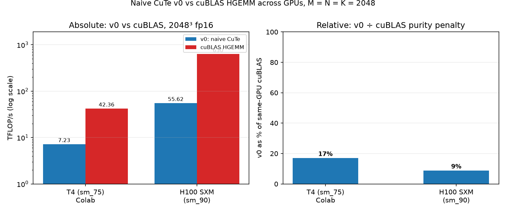

# GEMM: from naive CuTe to cuBLAS

### NOTE: All Kernels Are Handwritten For Learning Purposes. Claude/DeepSeek Helped With Benchmarking. 


These are Fp16 tensor-core GEMM written with CUTLASS/CuTe on a Tesla T4 (sm_75) just because I am GPU-poor. Each kernel version is benchmarked against cuBLAS, so every optimization is measured against a fixed reference.

Update: Now, I'm GPU-rich. I didn't know I had an unused FlashInfer Modal credits from February. But thanks to [Bikram Mahji](https://github.com/bikrammajhi). Will be profiling my kernels with Hopper/Blackwell. 

## Results

Problem: `M = N = K = 2048`, fp16 inputs, fp32 accumulation. One kernel, three GPUs — the T4 table is the original GPU-poor baseline; the H100 and B200 tables are the same kernel and harness rerun on Modal.

### Tesla T4 (sm_75) — Colab baseline

| Version | Time (ms) | TFLOP/s | % of cuBLAS | What changed |
|---|---|---|---|---|
| cuBLAS (reference) | 0.406 | 42.36 | 100% | `cublasGemmEx`, tensor-op algo |
| v0: naive CuTe | 2.375 | 7.23 | 17% | Fragments loaded straight from global memory |
| v1: shared memory | TBD | TBD | TBD | Cooperative global-to-shared copy |
| v2: vectorized copy | TBD | TBD | TBD | `TiledCopy` with 128-bit loads |
| v3: swizzled smem | TBD | TBD | TBD | Bank-conflict-free shared layout |
| v4: pipelined | TBD | TBD | TBD | Overlap next k-tile load with MMA |

### NVIDIA H100 SXM 80GB (sm_90) — Modal

| Version | Time (ms) | TFLOP/s | % of cuBLAS | What changed |
|---|---|---|---|---|
| cuBLAS HGEMM (reference) | 0.027 | 630.38 | 100% | same `cublasGemmEx` call as the T4 row |
| v0: naive CuTe | 0.310 | 55.6 | 9% | not changed — same SM75 atom, still no shared memory |

NCU (full set): Memory SOL 92% driven by **L1/TEX at 96%**, while Compute sits at 11% and DRAM at 2% — every operand tile is re-read through the L1 datapath, so the tensor cores mostly wait. v0 is **7.6× faster** than on T4 in absolute terms, yet a *smaller* fraction of cuBLAS: the latency-limited naive kernel barely scales, while cuBLAS's tuned Hopper path does.

### NVIDIA B200 (sm_100) — Modal

| Version | Time (ms) | TFLOP/s | % of cuBLAS | What changed |
|---|---|---|---|---|
| cuBLAS HGEMM (reference) | 0.014 | 1188.71 | 100% | same `cublasGemmEx` call again |
| v0: naive CuTe | 0.298 | 57.7 | 5% | still the same SM75 atom; v0 gains only ~4% over its own H100 number while cuBLAS almost doubles |

NCU (full set, 41 passes): the same L1 wall — **L1/TEX at 96%** and Memory SOL 83%, with Compute at 20% and DRAM at 0.7% (IPC 0.39, 303 µs vs 308 µs on H100 at the same ~1.8 GHz). Blackwell's wider SM buys a little more compute headroom, not a better data path: the naive global-to-register pipeline still saturates L1 while the tensor cores wait.

The gap widens every generation: **17% → 9% → 5%** of same-GPU cuBLAS. v0 barely moves from H100 to B200 (55.6 → 57.7 TFLOP/s) because its ceiling is the L1/latency path of the naive global-to-register pipeline, not FLOPs — while cuBLAS (630 → 1187 TFLOP/s) rides Blackwell's tensor cores, TMA and wider memory system. That is precisely what the v1+ ladder (shared memory → `TiledCopy` → swizzling → pipelining) is meant to recover.



*Generated by `figures/make_figures.py` from the runner's `bench_all.csv` (medians per GPU); the T4 bars are the original Colab baseline from the table above.*

## v0: naive CuTe baseline

- **Tile:** 128 x 128 x 32 per thread block, 128 threads (2 x 2 warps).
- **MMA atom:** `SM75_16x8x8_F32F16F16F32_TN` (Turing tensor core, fp16 in, fp32 accumulate).
- **Data path:** global memory directly into registers, then MMA. No shared memory, no pipelining.
- **Why it is slow:** every warp fetches its own A and B fragments from global memory, so the same tile data is loaded repeatedly and nothing hides memory latency. This is the number the later versions are meant to beat.
- **Layouts:** `A` is `M x K` row-major, `B` is stored `N x K` (K contiguous), so the kernel computes `C = A * B^T`, with `C` row-major.
- **Limitations:** no bounds handling, so M, N, K must be multiples of 128, 128, 32.

## Methodology

Same kernel, same harness, three GPUs: `matmul_dummy.cu` compiled per-arch against CUTLASS **v4.8.1 (commit `2c85f49`)**, pinned in the Modal images at `/opt/cutlass` (release tarball, no in-image git).

| | Tesla T4 (sm_75) | H100 SXM 80GB (sm_90) | B200 (sm_100) |
|---|---|---|---|
| Where | Google Colab | Modal | Modal |
| CUDA | 13.0 (nvcc 13.0.88) | 12.4.0 | 13.3.1 — sm_100 needs ≥ 12.8, and CUTLASS 4.x recommends 13.3 for codegen |
| GPU selection | — | requested as `"H100!"`: Modal otherwise silently upgrades a plain `"H100"` request to an H200 (141 GB HBM, extra bandwidth), which would move the numbers | `"B200"` |
| NCU | — | `full` set on the first timed launch (skip 4 = correctness + 3 warmup launches), with the CUDA 13.3 image's NCU 2026.x — the 12.4 image's NCU 2024.1 cannot *prepare* sm_90 kernels for profiling against Modal's R610 driver ("Unknown Error on device 0" on every metric set) | same 13.3-image NCU, `full` set |
| Timing | `cudaEvent`, average over 20 iterations after 1 correctness + 1 `ref_gemm` + 3 warmup launches | same harness | same harness |
| Correctness | elementwise compare against a plain CUDA fp32-accumulate reference kernel; inputs are multiples of 0.25 so the compare is exact: 0 mismatches, max abs error 0 | same | same |
| cuBLAS call | `cublasGemmEx`, `CUBLAS_COMPUTE_32F`, `CUBLAS_GEMM_DEFAULT_TENSOR_OP` | same call, measured by `gemm/cublas_ref.cu` in its own 20-launch-avg run at 2048³ | same |

**Caveat:** Colab T4 clocks vary with thermals and power limits, so absolute numbers shift between runs (v0 measured 2.389 ms and 2.375 ms on two separate tries; table shows the second). Modal containers report their clocks per run (H100: 1.98 GHz SM / 2619 MHz HBM) and NCU ran with unmodified clocks (`--clock-control none`) — its kernel duration (307.5 µs) matched the event-timed 0.310 ms within 1%.

## Reproduce

Manual, any box with a CUDA ≥ 12.8 toolkit and CUTLASS headers on the path:

```bash
git clone --depth 1 https://github.com/NVIDIA/cutlass.git

nvcc -std=c++17 --expt-relaxed-constexpr -arch=sm_75 \
  -I cutlass/include \
  CuteAlgebra-Cutlass/cutlass_practice/matmul_dummy.cu -o cute_gemm -lcublas && ./cute_gemm
```

Or via the repo's Modal runner, which produced the H100/B200 rows, the rolling CSV and the downloadable `.ncu-rep` reports:

```bash
# From the repo root (bench + NCU + auto-open reports locally):
modal run modal/run_cuda.py --suite cutlass --mode both --gpu h100 --open-reports
modal run modal/run_cuda.py --suite cublas --mode warmup --size 2048 --gpu h100
# Blackwell: the same two commands with --gpu b200
```

Expected output format:

```
mismatches: 0, max abs error: 0
avg time: 2.375 ms, 7.23 TFLOP/s
cuBLAS: 0.406 ms, 42.36 TFLOP/s
```

## Next steps

Each step adds one row to the table above, timed with the same harness: shared memory staging, vectorized `TiledCopy`, swizzled shared layout, then software pipelining.