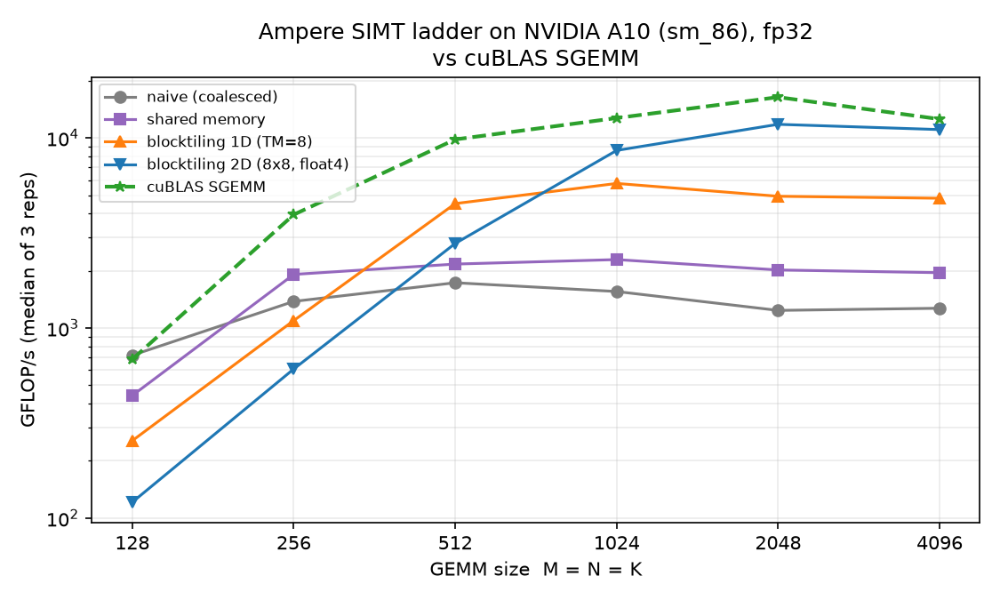
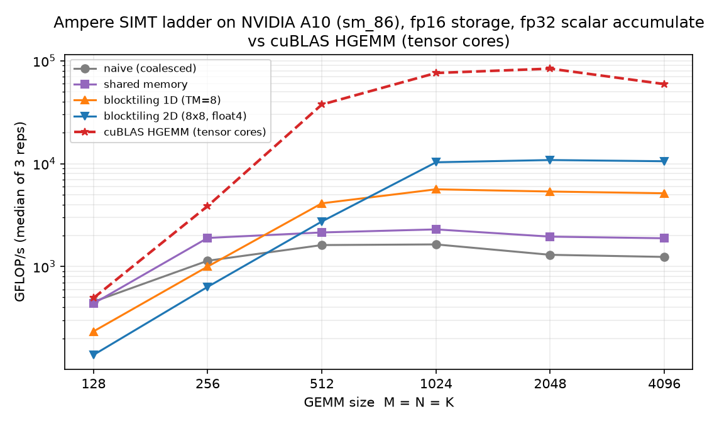
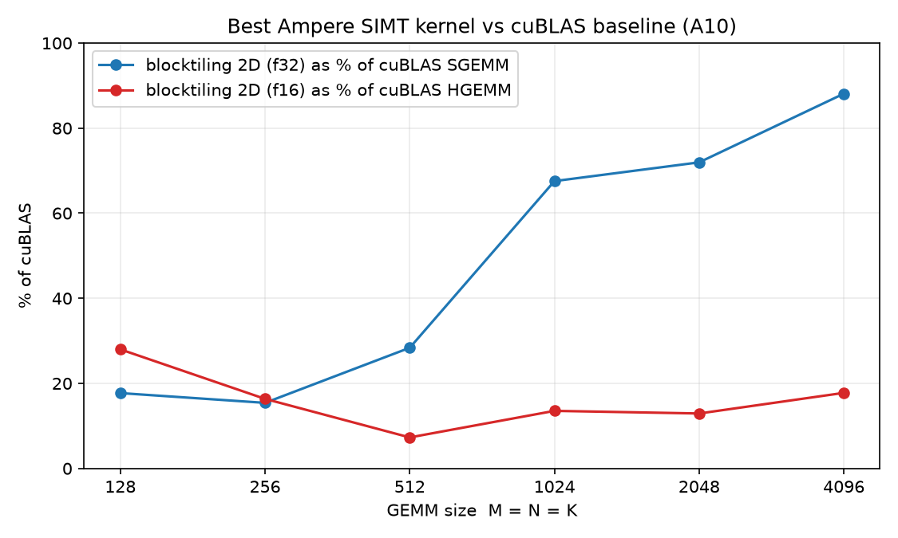

# GEMM: Ampere → Hopper → Blackwell

This is the repo's standalone CUDA C++ GEMM track, organized by target
architecture. `Ampere/` holds the original SIMT optimization ladder; the same
generic kernels are also run on H100 and B200 for a cross-generation comparison.
`Hopper/` and `Blackwell/` are reserved for architecture-specific tensor-core
work and currently contain only placeholders. All benchmark tables, NCU notes,
and reproduction commands stay in this README.

## Layout

| Path | Target | What it is | Status |
|---|---|---|---|
| `Ampere/` | SM80–SM86 | Eight SIMT kernels: naive, shared, 1D blocktiling, 2D blocktiling, each in fp32 and fp16 | Benchmarked on A10, H100, B200 |
| `Hopper/` | SM90 | Reserved for the WGMMA/TMA track | Empty |
| `Blackwell/` | SM100 | Reserved for the UMMA/Tensor Memory track | Empty |
| `cublas_ref.cu` | all | Shared cuBLAS SGEMM / HGEMM reference | Shared |
| `figures/` | A10 | Generated ladder plots and `make_figures.py` | A10 only |

`Hopper/` and `Blackwell/` each contain a `.gitkeep` so the empty directories
survive a clone. The implementation style for those tracks — raw CUDA/PTX or
CUTLASS/CuTe — is still TBD.

## Ampere

Eight standalone compute kernels form the classic optimization ladder, each one
a standalone binary that allocates its inputs, verifies against a CPU reference,
and benchmarks with CUDA events (5 warmup launches + 50 timed launches,
`GFLOP/s = 2·M·N·K / time`). `cublas_ref.cu` is the shared reference binary for
both dtypes.

| File | Idea |
|---|---|
| `Ampere/naive_f32.cu` / `Ampere/naive_f16.cu` | One thread per output element, no shared memory. A is broadcast, B is fetched through strided, mostly uncoalesced loads. |
| `Ampere/shared_f32.cu` / `Ampere/shared_f16.cu` | One thread per output element, but both matrix stages (32×32×32 tile, 1024 threads) staged in shared memory; MACs run against shared. |
| `Ampere/blocktiling_1d_f32.cu` / `Ampere/blocktiling_1d_f16.cu` | 64×64×16 block tile (BM=64, BN=64, BK=16); each thread owns a register tile of TM=8 rows so every A-value loaded to shared is reused TM times. 512 threads/block. |
| `Ampere/blocktiling_2d_f32.cu` / `Ampere/blocktiling_2d_f16.cu` | 128×128×16 block tile; each thread owns an 8×8 register tile (TM=8, TN=8, 256 threads). Global loads staged into shared with `float4` vectorized copies. |
| `cublas_ref.cu` | cuBLAS `sgemm` / `hgemm` baselines so the ladder has a target. |

`*_f16.cu` variants keep **fp16 storage with fp32 accumulation**, computed with
scalar `FMA` — no tensor cores. That detail is the single biggest number in this
write-up.

### Results

Problem: square GEMM, `M = N = K` from 128 to 4096, median of 3 reps. The A10
tables are the original baseline. The H100 and B200 tables rerun the exact same
generic SIMT kernels on newer GPUs; they are not architecture-specific H100 or
B200 implementations.

**A10 (sm_86) — original baseline**

*fp32 kernels*

| size | naive | shared | blocktiling 1D | blocktiling 2D | cuBLAS SGEMM |
|---|---|---|---|---|---|
| 128 | 719 | 441 | 255 | 121 | 684 |
| 256 | 1380 | 1914 | 1095 | 609 | 3948 |
| 512 | 1730 | 2169 | 4514 | 2785 | 9818 |
| 1024 | 1556 | 2291 | 5761 | 8594 | 12723 |
| 2048 | 1238 | 2020 | 4931 | **11789** | 16384 |
| 4096 | 1270 | 1955 | 4815 | **11061** | 12555 |

*fp16 storage, fp32 scalar accumulate (no tensor cores)*

| size | naive | shared | blocktiling 1D | blocktiling 2D | cuBLAS HGEMM (tensor cores) |
|---|---|---|---|---|---|
| 128 | 454 | 437 | 234 | 138 | 493 |
| 256 | 1137 | 1894 | 998 | 634 | 3874 |
| 512 | 1615 | 2142 | 4113 | 2739 | 37556 |
| 1024 | 1639 | 2294 | 5628 | 10309 | 76151 |
| 2048 | 1298 | 1951 | 5355 | **10841** | 83894 |
| 4096 | 1238 | 1880 | 5153 | **10549** | 59370 |

Jump straight to the headline: **the 2D-blocktiling f32 kernel reaches ~72% of
cuBLAS SGEMM at 2048³ and ~88% at 4096³** — without tensor cores, without async
copies, just tiling + register blocking + vectorized loads. The fp16 kernels
tell the other half of the story: they are statistically the *same speed as
their fp32 twins* (~11 vs ~11 TFLOP/s) while cuBLAS HGEMM rides tensor cores to
~84 TFLOP/s. Half-precision storage costs nothing scalar-wise and buys nothing —
until `mma` shows up.

**H100 (sm_90) — same SIMT ladder**

*fp32 kernels*

| size | naive | shared | blocktiling 1D | blocktiling 2D | cuBLAS SGEMM |
|---|---|---|---|---|---|
| 128 | 649 | 678 | 292 | 139 | 522 |
| 256 | 3045 | 3204 | 1271 | 691 | 2993 |
| 512 | 4635 | 8155 | 5255 | 2991 | 17885 |
| 1024 | 5102 | 9184 | 16244 | 12972 | 38192 |
| 2048 | 5483 | 9323 | 15744 | **32668** | 50807 |
| 4096 | 5430 | 9135 | 13644 | **33564** | 52137 |

*fp16 storage, fp32 scalar accumulate (no tensor cores)*

| size | naive | shared | blocktiling 1D | blocktiling 2D | cuBLAS HGEMM (tensor cores) |
|---|---|---|---|---|---|
| 128 | 467 | 675 | 256 | 154 | 480 |
| 256 | 2144 | 3238 | 1115 | 705 | 3822 |
| 512 | 3995 | 8556 | 4572 | 3016 | 30210 |
| 1024 | 4405 | 9583 | 13321 | 12458 | 228106 |
| 2048 | 4617 | 9936 | 15508 | **29703** | 622228 |
| 4096 | 4739 | 9641 | 15661 | **30443** | 700307 |

**B200 (sm_100) — same SIMT ladder**

*fp32 kernels*

| size | naive | shared | blocktiling 1D | blocktiling 2D | cuBLAS SGEMM |
|---|---|---|---|---|---|
| 128 | 752 | 702 | 296 | 148 | 733 |
| 256 | 3364 | 3280 | 1244 | 711 | 4623 |
| 512 | 5224 | 8097 | 5087 | 3157 | 21607 |
| 1024 | 5568 | 10384 | 15140 | 13219 | 47579 |
| 2048 | 6030 | 10668 | 17794 | **35293** | 55861 |
| 4096 | 6166 | 10568 | 14810 | **36327** | 63561 |

*fp16 storage, fp32 scalar accumulate (no tensor cores)*

| size | naive | shared | blocktiling 1D | blocktiling 2D | cuBLAS HGEMM (tensor cores) |
|---|---|---|---|---|---|
| 128 | 670 | 705 | 274 | 153 | 696 |
| 256 | 2875 | 3284 | 1153 | 697 | 4577 |
| 512 | 4353 | 8481 | 4684 | 2991 | 40474 |
| 1024 | 4789 | 10890 | 12512 | 12232 | 302265 |
| 2048 | 4920 | 11267 | 17184 | **25301** | 1185774 |
| 4096 | 5136 | 11445 | 18194 | **27694** | 1482885 |

**Cross-generation takeaway**

At 4096³, the 2D-blocktiling f32 kernel goes from 11.1 TFLOP/s on A10 to
33.6 TFLOP/s on H100 and 36.3 TFLOP/s on B200. That is real scaling, but cuBLAS
SGEMM climbs from 12.6 to 52.1 to 63.6 TFLOP/s over the same three GPUs, so the
hand-written kernel's share falls from **88% → 64% → 57%**. The fp16 story is
starker: the 2D kernel stays at 10.5 → 30.4 → 27.7 TFLOP/s while cuBLAS HGEMM
uses tensor cores to reach 59.4 → 700.3 → 1482.9 TFLOP/s, leaving the SIMT
kernel at **18% → 4.3% → 1.9%** of the reference. The Ampere ladder is a memory/
instruction-level exercise; the H100 and B200 tracks exist to replace that
scalar-FMA path with WGMMA and UMMA/Tensor Memory.

### Figures

Regenerate anytime with `.venv/bin/python gemm/figures/make_figures.py
[path/to/bench_all.csv]` (matplotlib inside the repo venv; the script defaults
to the Oct 27 2026 A10 sweep). The figures are A10-only; the H100/B200 results
are tabulated above.







### NCU at 4096³ on A10 (Speed-of-Light summary)

| kernel | duration | SM % | DRAM % | L1/TEX % | achieved occ. | regs/thread |
|---|---|---|---|---|---|---|
| naive_f32 | 99.8 ms | 98.6 | 43.7 | 98.6 | 99.7 % | 40 |
| naive_f16 | 104.7 ms | 98.0 | 27.3 | 98.5 | 99.5 % | 26 |
| shared_f32 | 66.9 ms | 80.5 | 27.1 | 81.2 | 66.4 % | 38 |
| shared_f16 | 69.1 ms | 78.6 | 15.6 | 79.0 | 66.7 % | 36 |
| blocktiling_1d_f32 | 24.3 ms | 73.9 | 31.4 | 74.5 | 66.2 % | 58 |
| blocktiling_1d_f16 | 21.7 ms | 88.6 | 20.1 | 89.0 | 98.3 % | 40 |
| blocktiling_2d_f32 | 10.25 ms | 58.1 | 20.6 | 82.7 | 32.6 % | 122 |
| blocktiling_2d_f16 | 10.8 ms | 68.4 | 11.3 | 44.7 | 32.4 % | 128 |

Readings worth internalizing, one per rung:

1. **naive (99.8 ms)** — "high utilization" is not "efficient". SM and L1/TEX
   throughput both sit at ~98%, occupancy ~100%, and yet the kernel delivers
   ~4% of the device's fp32 peak. Every warp is saturated *issuing redundant
   work*: one thread per output element means each warp pulls 32 different
   rows/cols of A and B, so B's stride-1-column loads replay the same sectors
   over and over (DRAM traffic at 43.7% is almost all duplication). The
   pipelines are busy; the FLOPs are not.

2. **shared (67 ms)** — staging A and B tiles once per 32-k-tile in shared
   memory cuts duration by a third (99.8 → 66.9 ms) and L1/TEX utilization
   from 98.6% to 81.2%, at the cost of occupancy (66%: 8KB of shared +
   1024-thread blocks). The MAC loop
   is unchanged — every thread still re-loads sA/sB per dot product — so the
   ceiling is instruction throughput, and DRAM is quiet (27%) rather than
   done.

3. **blocktiling 1D (24 ms)** — giving each thread TM=8 register-resident rows
   halves the number of shared reads per useful FLOP again and shifts the
   balance: SM busy 74%, DRAM 31%. This is the first kernel whose bottleneck
   is the *memory system as a whole* rather than redundant L1 replay.

4. **blocktiling 2D (10.25 ms)** — 16× fewer output tiles, `float4` staging,
   8×8 register tiles per thread, ~10× faster than naive and ~6.5× faster than
   the shared-memory version. The trade shows up
   as occupancy collapsing to 32.6% — 128 regs/thread means only ~2 blocks of
   256 threads fit per SM's 64K-register file, and the SM spends part of its
   issue slots stalled (SM busy 58%). The f32 version runs aground on shared
   memory bandwidth (L1/TEX 82.7%); the f16 twin, with lighter shared traffic
   (44.7%), starts leaning on the compute pipes (68.4%). Both readings point
   the same way: the scalar FMA path is the thing to replace next.

5. **cuBLAS** — SGEMM peaks at 16.4 TFLOP/s (2048³), i.e. ~53% of A10's fp32
   peak; the hand-written 2D tiler reaches 72–88% of that without ever
   touching tensor cores. HGEMM at 84 TFLOP/s is a different instruction-set
   conversation (`mma.m16n8k16` with fp32 accumulate) and is the next ladder
   entirely.

The NCU numbers are A10-only. H100 and B200 were benchmarked with the same
harness but were not NCU-profiled in this pass.

### Running and profiling

Standalone (needs `common/cuda_utils.cuh`; sizes must be multiples of the tile
sizes, default 1024). The relative include resolves from the source file, so
these commands work from the repo root:

```bash
nvcc -O3 -std=c++17 -arch=native gemm/Ampere/blocktiling_2d_f32.cu -o b2d
./b2d 4096          # 4096 x 4096 x 4096
./b2d 4096 2048 512 # M=4096, N=2048, K=512
```

No local CUDA toolkit required — `modal/run_cuda.py` copies the repo into a
CUDA container, compiles, benchmarks, and NCU-profiles. See the root README for
the full flag list. The A10 command that produced the original ladder and NCU
write-up:

```bash
modal run modal/run_cuda.py --suite all --mode all --size 4096 --gpu a10 --open-reports
```

The H100 and B200 cross-generation tables were produced with:

```bash
modal run modal/run_cuda.py --suite all --mode sweep --gpu h100
modal run modal/run_cuda.py --suite all --mode sweep --gpu b200
```

Median-of-3 results land in `modal/reports/<run_id>/bench_all.csv` (all sizes
128…4096, 3 reps). `--mode ncu-sweep` additionally writes one NCU report per
kernel per size, exported as both `.ncu-rep` (GUI) and `_details.txt` /
`_raw.csv` (text).

### Methodology

| | A10 (sm_86) | H100 (sm_90) | B200 (sm_100) |
|---|---|---|---|
| Where | Modal | Modal, GPU pinned as `H100!` | Modal |
| CUDA | 12.4.0 | 12.4.0 | 13.3.1 |
| Timing | 5 warmup + 50 timed launches per rep, 3 reps, median | same harness | same harness |
| Correctness | sampled compare against a CPU reference; 0 mismatches at every size | same | same |
| cuBLAS | `cublasSgemm` (default FP32, no TF32) and `cublasGemmEx` fp16→fp32→fp16 tensor-op | same calls | same calls |
| NCU | `--launch-skip 6`, `--launch-count 1`, `--set full`, `--clock-control none` | not profiled | not profiled |

Reports: the A10 numbers come from `modal/reports/20261027T065855Z/`, with the
smaller `20261027T065505Z/` and `20261027T065012Z/` runs alongside it. The
H100 table comes from `modal/reports/20261105T064144Z/` and the B200 table from
`modal/reports/20261105T065011Z/`. An A10 warmup after the directory move is in
`modal/reports/20261105T063955Z/`.

One caveat NCU itself prints on every report: profiling ran with
`--clock-control none` so the SM frequency reflects whatever clocks the
benchmark had ramped to (`nvidia-smi` snapshots: 1095–1290 MHz across the
A10 run). Cross-kernel comparisons within a run are sound; absolute GFLOP/s can
wobble a few percent with the state of the die that day. The H100/B200 sweep
rows record their own clock snapshots in `bench_all.csv`.

## Hopper

`Hopper/` is reserved for the SM90 track and currently contains only
`.gitkeep`; there are no kernels or benchmark rows yet. Implementation style
and file progression are TBD. Candidate topics when the track starts: WGMMA
fragments and synchronization, TMA loads, and multistage / warp-specialized
pipelining.

## Blackwell

`Blackwell/` is reserved for the SM100 track and currently contains only
`.gitkeep`; there are no kernels or benchmark rows yet. Implementation style
and file progression are TBD. Candidate topics: UMMA with Tensor Memory, TMA,
clusters / multicast, 2-SM MMA, and the epilogue.

## Roadmap

### Ampere

- [x] v0: naive kernel
- [x] shared-memory staging
- [x] 1D blocktiling
- [x] 2D blocktiling with vectorized loads
- [ ] `cp.async` double-buffering — overlap the global→shared copy of tile
  k+1 with the MAC loop of tile k.
- [ ] Occupancy vs ILP tuning on 2D — 128 regs/thread is the limiter at 32%
  occupancy; smaller TM/TN or `__launch_bounds__` pressure trades reusability
  for more blocks in flight.
- [ ] Tensor cores — replace the 8×8 scalar FMA tile with `ldmatrix` +
  `mma.sync.m16n8k16` (fp16 in, fp32 accumulate) and chase the cuBLAS HGEMM
  band.

### Hopper

- [ ] Choose the implementation style (raw CUDA/PTX vs CUTLASS/CuTe)
- [ ] Define the WGMMA/TMA/pipelining progression

### Blackwell

- [ ] Choose the implementation style (raw CUDA/PTX vs CUTLASS/CuTe)
- [ ] Define the UMMA/Tensor Memory progression
